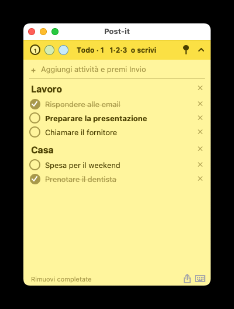
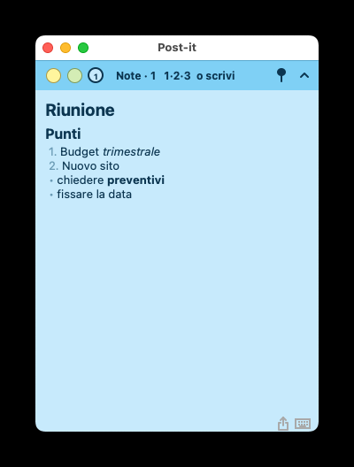

# Post-it

Tre foglietti per Windows 10/11 e Mac che restano sopra le altre finestre: uno per le cose da fare, uno per note e attività, uno solo per le note. Li apri con una scorciatoia mentre lavori e li richiudi subito.

| Verde: note + attività | Azzurro: note formattate |
|---|---|
|  |  |

## Scarica

### Windows

**[⬇ Scarica PostIt.exe](https://github.com/PellicanKing/post-it/releases/latest/download/PostIt.exe)** (ultima versione, nessuna installazione)

Al primo avvio Windows può mostrare «Windows ha protetto il PC»: clicca **Ulteriori informazioni** → **Esegui comunque**. Succede con i programmi non firmati scaricati da internet; il codice completo è qui sotto.

Per averlo a ogni accensione del PC: apri il riquadro delle scorciatoie (simbolo della tastiera in basso a destra) e attiva **Avvia con Windows**. Così le scorciatoie funzionano subito, senza aprirlo a mano.

### Mac (Apple Silicon e Intel, macOS 11 o successivo)

**[⬇ Scarica Post-it-Mac.dmg](https://github.com/PellicanKing/post-it/releases/latest/download/Post-it-Mac.dmg)**

1. Apri il file `.dmg` e trascina **Post-it** nella cartella **Applicazioni**.
2. La prima volta macOS dice che non può verificare lo sviluppatore (l'app non è firmata da Apple):
   - **macOS 15 o successivo:** prova ad aprirla, poi vai in **Impostazioni di Sistema → Privacy e sicurezza** e clicca **Apri comunque**.
   - **macOS 14 o precedente:** tasto destro (o Ctrl-clic) sull'app → **Apri** → **Apri**.
3. Dal riquadro delle scorciatoie attiva **Apri al login** per averlo a ogni accensione.

Sul Mac il post-it è una vera finestra macOS (pulsanti rosso/giallo/verde, angoli arrotondati, carattere di sistema) con caselle tonde come in Promemoria. Le scorciatoie usano `⌃⌥` al posto di `Ctrl+Alt` e non chiedono permessi di Accessibilità. `⌘,` apre le impostazioni, `⌘W` nasconde, `⌘Q` esce.

| Mac: giallo | Mac: azzurro |
|---|---|
|  |  |

Il pulsante ✕ (o il pallino rosso sul Mac) **nasconde** il post-it senza chiuderlo, così le scorciatoie restano attive. Per chiuderlo davvero: riquadro delle scorciatoie → **Esci da Post-it**.

## I tre post-it

- **Giallo**: solo attività, clicchi e si barrano
- **Verde**: note sopra e attività sotto, divise a metà
- **Azzurro**: solo note

Ogni colore ha **due post-it** (1 e 2). Per passare all'altro, premi di nuovo la scorciatoia o il numero del colore già aperto, oppure clicca di nuovo il suo quadratino. Il quadratino del colore aperto mostra **1** o **2**.

Il post-it resta sempre dentro lo schermo, anche quando lo trascini o lo ridimensioni. Con due monitor lo porti sull'altro trascinandolo con il mouse.

## Scorciatoie

Funzionano anche mentre usi altri programmi. Si cambiano dal simbolo della tastiera in basso a destra del post-it. Sul Mac `Ctrl+Alt` diventa `⌃⌥` (Control+Opzione) e `Ctrl+B`/`Ctrl+I` diventano `⌘B`/`⌘I`.

| Tasti | Cosa fa |
|---|---|
| `Ctrl+Alt+N` | Porta il post-it davanti per scrivere; premuta di nuovo lo nasconde |
| `Ctrl+Alt+1` / `2` / `3` | Apre il giallo, il verde o l'azzurro; premuta di nuovo, passa all'altro post-it dello stesso colore |
| `Ctrl+Alt+P` | Fisso sopra le altre finestre, oppure no |
| `Ctrl+Alt+H` | Nasconde o mostra |
| `Ctrl+Alt+G` | Riduce alla sola barra o espande (modalità grande attivabile) |
| `1` `2` `3` | Sul post-it, quando non stai scrivendo: cambia colore; di nuovo lo stesso numero, l'altro dei due |
| `Esc` | Smetti di scrivere |

## Scrivere con stile

| Scrivi | Ottieni |
|---|---|
| `#` / `##` / `###` + spazio | Titolo grande, medio, piccolo |
| `-` + spazio | Elenco puntato |
| `3.` + spazio | Elenco numerato che parte da 3 |
| `Tab` o doppio spazio, subito dopo | Annulla e lascia `- ` come testo normale |
| `*testo*` o `Ctrl+B` | **Grassetto** |
| `_testo_` o `Ctrl+I` | *Corsivo* |

Nelle liste di attività `# Lavoro` crea un titolo di sezione. La freccia in basso a destra esporta il post-it aperto, o tutti, in un file di testo (in `Documenti\Post-it`).

I dati restano sul tuo computer: `%APPDATA%\PostIt\postit.json` su Windows, `~/Library/Application Support/PostIt/postit.json` sul Mac. Nella stessa cartella `postit.log` annota avvii ed eventuali errori: se qualcosa non va, è il primo file da guardare.

## Modificarlo

È un unico file Python con tkinter, senza librerie esterne, che funziona su Windows e Mac.

| File | |
|---|---|
| `PostIt.pyw` | tutto il programma: colori (`NOTES`) e scorciatoie predefinite (`ACTIONS`) sono all'inizio |
| `build_exe.bat` | ricrea `PostIt.exe` nella cartella `dist` (serve [Python 3](https://www.python.org/downloads/)) |
| `.github/workflows/mac.yml` | crea `Post-it-Mac.dmg` su un Mac di GitHub e lo aggiunge a ogni release |
| `tests/mac_check.py` | prova automatica della versione Mac, con screenshot |
| `make_icon.py` | rigenera l'icona: `py make_icon.py postit.ico anteprima.png` |

Per provarlo senza exe: installa Python 3 e fai doppio clic su `PostIt.pyw` (sul Mac: `python3 PostIt.pyw`).

## Licenza

[MIT](LICENSE): puoi usarlo, modificarlo e ridistribuirlo.
