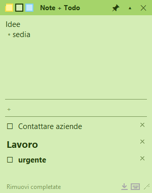
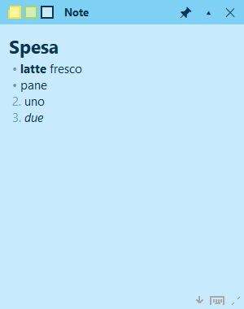

# Post-it

Tre foglietti per Windows 10/11 che restano sopra le altre finestre: uno per le cose da fare, uno per note e attività, uno solo per le note. Li apri con una scorciatoia mentre lavori e li richiudi subito.

| Verde: note + attività | Azzurro: note formattate |
|---|---|
|  |  |

## Scarica

**[⬇ Scarica PostIt.exe](https://github.com/PellicanKing/post-it/releases/latest/download/PostIt.exe)** (ultima versione, nessuna installazione)

Al primo avvio Windows può mostrare «Windows ha protetto il PC»: clicca **Ulteriori informazioni** → **Esegui comunque**. Succede con i programmi non firmati scaricati da internet; il codice completo è qui sotto.

Per averlo a ogni accensione del PC: apri il riquadro delle scorciatoie (simbolo della tastiera in basso a destra) e attiva **Avvia con Windows**. Così le scorciatoie funzionano subito, senza aprirlo a mano.

## I tre post-it

- **Giallo**: solo attività, clicchi e si barrano
- **Verde**: note sopra e attività sotto, divise a metà
- **Azzurro**: solo note

## Scorciatoie

Funzionano anche mentre usi altri programmi. Si cambiano dal simbolo della tastiera in basso a destra del post-it.

| Tasti | Cosa fa |
|---|---|
| `Ctrl+Alt+N` | Porta il post-it davanti per scrivere; premuta di nuovo lo nasconde |
| `Ctrl+Alt+1` / `2` / `3` | Apre il giallo, il verde o l'azzurro |
| `Ctrl+Alt+P` | Fisso sopra le altre finestre, oppure no |
| `Ctrl+Alt+H` | Nasconde o mostra |
| `Ctrl+Alt+G` | Riduce alla sola barra o espande (modalità grande attivabile) |
| `1` `2` `3` | Sul post-it, quando non stai scrivendo: cambia colore |
| `Esc` | Smetti di scrivere |

## Scrivere con stile

| Scrivi | Ottieni |
|---|---|
| `#` / `##` / `###` + spazio | Titolo grande, medio, piccolo |
| `-` + spazio | Elenco puntato |
| `3.` + spazio | Elenco numerato che parte da 3 |
| `Tab` o doppio spazio, subito dopo | Annulla e lascia `- ` come testo normale |
| `*testo*` o `Ctrl+B` | **Grassetto** |
| `_testo_` o `Ctrl+I` | *Corsivo* |

Nelle liste di attività `# Lavoro` crea un titolo di sezione. La freccia in basso a destra esporta un post-it o tutti e tre in un file di testo (in `Documenti\Post-it`).

I dati restano sul tuo PC, in `%APPDATA%\PostIt\postit.json`.

## Modificarlo

È un unico file Python con tkinter, senza librerie esterne.

| File | |
|---|---|
| `PostIt.pyw` | tutto il programma: colori (`NOTES`) e scorciatoie predefinite (`ACTIONS`) sono all'inizio |
| `build_exe.bat` | ricrea `PostIt.exe` nella cartella `dist` (serve [Python 3](https://www.python.org/downloads/)) |
| `make_icon.py` | rigenera l'icona: `py make_icon.py postit.ico anteprima.png` |

Per provarlo senza exe: installa Python 3 e fai doppio clic su `PostIt.pyw`.

## Licenza

[MIT](LICENSE): puoi usarlo, modificarlo e ridistribuirlo.
